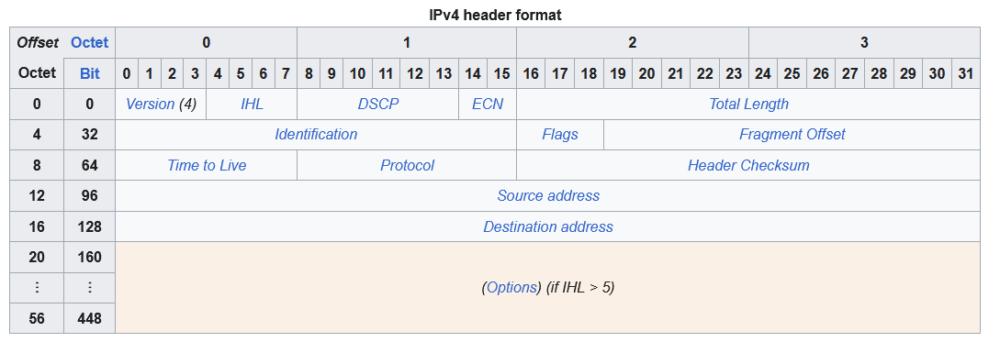

# IPv4 Header

Day 10 of CCNA 200-301 course by Jeremy IT Lab

## What is it?

It is the header appended to a segment/datagram.

## Version

4 byte indicating the version of IP.

## Internet Header Length (IHL)

Identifies the length of the header in 4 byte increments.

Example: if value is 1010 (10) --> 10 \* 4-bytes = 40-bytes

Minimum: 5 -> 20 bytes, Maximum: 15 -> 60 bytes

## Differentiated Services Code Point (DSCP)

Length: 6 bits

It is for Quality of Service (QoS).